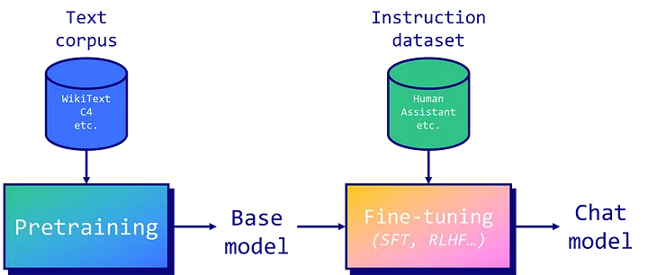

# Fine-Tuning an Open-Source LLM

A lightweight Python package for supervised fine-tuning (SFT) of open-source language models on custom datasets, with fast inference via vLLM.

The default model is [Phi-3-mini-4k-instruct](https://huggingface.co/microsoft/Phi-3-mini-4k-instruct), but the scripts work with any causal LM on HuggingFace.



## What's in here

- **Data formatting** — converts your JSON dataset into Phi-3 ChatML or Alpaca format, splits into train/val/test
- **Training** — LoRA fine-tuning via [Unsloth](https://github.com/unslothai/unsloth) + TRL SFTTrainer; falls back to vanilla HuggingFace on macOS/CPU
- **Inference** — [vLLM](https://github.com/vllm-project/vllm) for production throughput on Linux/GPU, Transformers for everything else
- **Modular structure** — each component (data, model, training, inference) lives in its own module under `src/phi3_sft/`

## Quick start

```bash
# install base deps
uv sync

# format your data
uv run python scripts/prepare_data.py --raw-path data/mock_dataset.json --format phi3

# train (3-step smoke test, no GPU needed)
uv sync --group train
uv run --group train python scripts/train.py \
    --local-model-dir models/smollm2-360m \
    --no-unsloth --quantization none \
    --max-steps 3 --batch-size 1 --grad-accum 1 \
    --output-dir outputs/smoke-test --report-to none --merge

# run inference
uv run python scripts/inference.py \
    --model-path outputs/smoke-test/merged \
    --engine transformers \
    --prompt "Write a Python function to reverse a string"
```

For a full walkthrough with your own data, see [HOWTO.md](HOWTO.md).

## Project structure

```
src/phi3_sft/
    config.py          # dataclasses for model, LoRA, training, data, inference settings
    data/
        formatter.py   # Phi3ChatMLFormatter, AlpacaFormatter
        dataset.py     # DatasetLoader: load, split, format, save
    model/
        loader.py      # ModelLoader: download from HF, load with optional LoRA, merge adapter
    training/
        trainer.py     # SFTTrainerWrapper: setup, train, save adapter, merge and export
    inference/
        engine.py      # VLLMInferenceEngine, TransformersInferenceEngine, get_engine()
scripts/
    prepare_data.py    # CLI: format raw data into train/val/test splits
    download_model.py  # CLI: download a model from HuggingFace Hub
    train.py           # CLI: run SFT training
    inference.py       # CLI: run inference on a fine-tuned model
```

## Platform notes

Training with Unsloth and 4-bit quantization requires Linux + CUDA. On macOS, pass `--no-unsloth --quantization none` and training runs on MPS/CPU without issue, just slower. vLLM is Linux/CUDA only — use `--engine transformers` everywhere else.

## Data format

Your dataset should be a JSON array:

```json
[
  {
    "instruction": "Classify the sentiment of this review.",
    "input": "The product broke after one day.",
    "response": "negative"
  }
]
```

`input` is optional. See [HOWTO.md](HOWTO.md) for the full pipeline.

## Tests

```bash
uv sync --group dev
uv run pytest tests/ -v
```
